<div align="center">


**Envio um arquivo de texto ao S3 e recebo a contagem de palavras por e-mail, sem gerenciar nenhum servidor** 📄⚡📧

</div>

---

## 📌 Sobre o projeto

Neste desafio do **AWS re/Start**, criei uma função **AWS Lambda em Python** que **conta as palavras** de um arquivo de texto e informa o resultado por **e-mail**.

O fluxo é totalmente **orientado a eventos**:

1. 📤 Faço o **upload** de um arquivo `.txt` em um bucket do **Amazon S3**
2. ⚡ O S3 **aciona automaticamente** a função Lambda
3. 🧮 A função lê o arquivo, **conta as palavras** e monta a mensagem
4. 📣 A mensagem é publicada em um tópico do **Amazon SNS**
5. 📧 O SNS entrega o resultado por **e-mail**, com o assunto **Word Count Result**

A mensagem segue o formato exigido pelo desafio:

```text
The word count in the <nome-do-arquivo> file is nnn.
```

---

## 🎯 Objetivos

- ✅ Criar uma **função Lambda em Python** pelo Console da AWS
- ✅ Usar o perfil IAM existente **`LambdaAccessRole`**
- ✅ Configurar um **bucket do S3** que invoca a função quando um arquivo é enviado
- ✅ Criar um **tópico do SNS** com assinatura de **e-mail**
- ✅ Formatar a mensagem e o assunto do e-mail conforme o desafio
- ✅ Testar com arquivos de **diferentes contagens de palavras**
- ✅ Acompanhar a execução pelos **logs do CloudWatch**

---

## 🗺️ Arquitetura

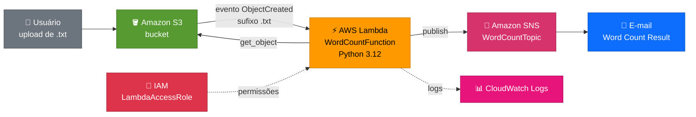

---

## 🧰 Serviços utilizados

| 🎨 Categoria | 🔧 Serviço | 📝 Função no projeto |
|:---:|:---:|---|
| ⚡ Compute | **AWS Lambda** | Executa o código que conta as palavras |
| 🪣 Storage | **Amazon S3** | Recebe os arquivos de texto e dispara o evento |
| 📣 Mensageria | **Amazon SNS** | Entrega o resultado por e-mail |
| 🔐 Segurança | **AWS IAM** | Perfil `LambdaAccessRole` com as permissões da função |
| 📊 Monitoramento | **Amazon CloudWatch Logs** | Registra cada execução da função |
| 🐍 Linguagem | **Python 3.12 + boto3** | Código da função e acesso a S3 e SNS |

---

## ⚙️ Configuração utilizada

| 🔹 Recurso | 🔸 Valor |
|---|---|
| **Região** | `us-west-2` (Oregon): bucket, tópico e função na mesma região |
| **Função Lambda** | `WordCountFunction` · Python 3.12 · timeout de 10 s |
| **Perfil de execução** | `LambdaAccessRole` (perfil existente do laboratório) |
| **Variável de ambiente** | `TOPIC_ARN`: ARN do tópico SNS |
| **Gatilho** | S3 · evento `s3:ObjectCreated:*` · sufixo `.txt` |
| **Tópico SNS** | `WordCountTopic` · tipo **Standard** |
| **Assinatura** | Protocolo **Email** (confirmada) |
| **Assunto do e-mail** | `Word Count Result` |

---

## 💻 Código da função

```python
import os
import urllib.parse
import boto3

s3 = boto3.client("s3")
sns = boto3.client("sns")

TOPIC_ARN = os.environ["TOPIC_ARN"]


def lambda_handler(event, context):
    results = []

    for record in event["Records"]:
        bucket = record["s3"]["bucket"]["name"]
        key = urllib.parse.unquote_plus(record["s3"]["object"]["key"])

        # Lê o arquivo de texto do S3
        obj = s3.get_object(Bucket=bucket, Key=key)
        text = obj["Body"].read().decode("utf-8", errors="ignore")

        # Conta as palavras
        word_count = len(text.split())
        file_name = key.split("/")[-1]

        message = f"The word count in the {file_name} file is {word_count}."

        # Publica no tópico SNS
        sns.publish(
            TopicArn=TOPIC_ARN,
            Subject="Word Count Result",
            Message=message,
        )

        print(message)
        results.append(message)

    return {"statusCode": 200, "body": results}
```

**Decisões de implementação:**

| 🧩 Detalhe | 💡 Motivo |
|---|---|
| `TOPIC_ARN` em **variável de ambiente** | Evita deixar o ARN fixo no código e facilita trocar o tópico |
| `unquote_plus` na chave do objeto | O S3 envia nomes com espaços e caracteres especiais codificados |
| `for record in event["Records"]` | Trata todos os arquivos que chegarem em um mesmo evento |
| `errors="ignore"` ao decodificar | Evita que um caractere inválido interrompa a função |
| `print(message)` | Grava o resultado nos **logs do CloudWatch** |

---

## 🧪 Testes realizados

Enviei três arquivos de texto com contagens conhecidas e conferi o resultado recebido por e-mail:

| 📄 Arquivo | 📝 Conteúdo | 🎯 Esperado | ✅ Recebido |
|---|---|:---:|:---:|
| `sample1.txt` | `Hello AWS Lambda` | 3 | **3** |
| `sample2.txt` | `The quick brown fox jumps over the lazy dog` | 9 | **9** |
| `sample3.txt` | `Serverless computing lets developers run code without provisioning or managing servers and pay only for the compute time they consume` | 20 | **20** |

---

## 🪜 Passo a passo resumido

1. 📣 Criar o tópico **SNS** `WordCountTopic` e a assinatura de **e-mail**, confirmando pelo link recebido
2. 🪣 Criar o **bucket do S3** na mesma região
3. ⚡ Criar a função **`WordCountFunction`** (Python 3.12) usando o perfil **`LambdaAccessRole`**
4. 📝 Colar o código, clicar em **Deploy** e definir a variável `TOPIC_ARN`
5. 🔗 Adicionar o **gatilho do S3** (eventos de criação de objeto, sufixo `.txt`)
6. 📤 Enviar os arquivos `sample1.txt`, `sample2.txt` e `sample3.txt`
7. 📧 Conferir os e-mails **Word Count Result** com a contagem
8. 📊 Conferir os **logs** no CloudWatch

---

## 📸 Evidências

### 1️⃣ Tópico SNS criado
O tópico `WordCountTopic`, do tipo **Standard**.

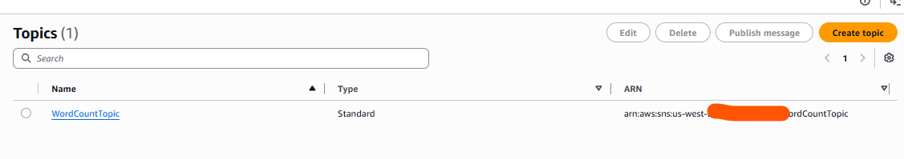

### 2️⃣ Confirmação da assinatura
O e-mail **AWS Notification - Subscription Confirmation**, com o link para confirmar a assinatura. Sem esse passo, o SNS não entrega as mensagens.

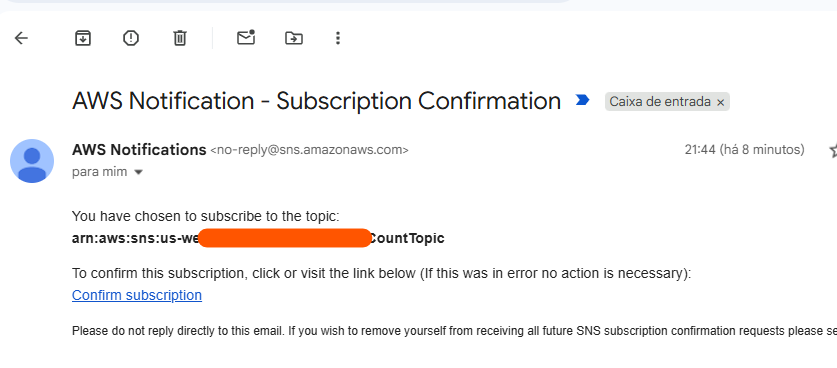

### 3️⃣ Bucket do S3
O bucket criado na região **US West (Oregon) `us-west-2`**, a mesma da função e do tópico.

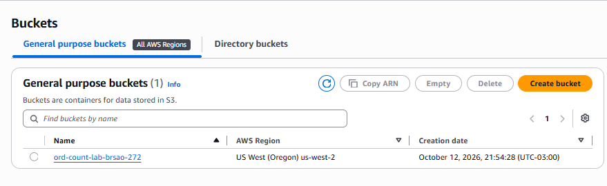

### 4️⃣ Código da função
O arquivo `lambda_function.py` da `WordCountFunction`, com o botão **Deploy** indicando que o código está publicado (*Current*).

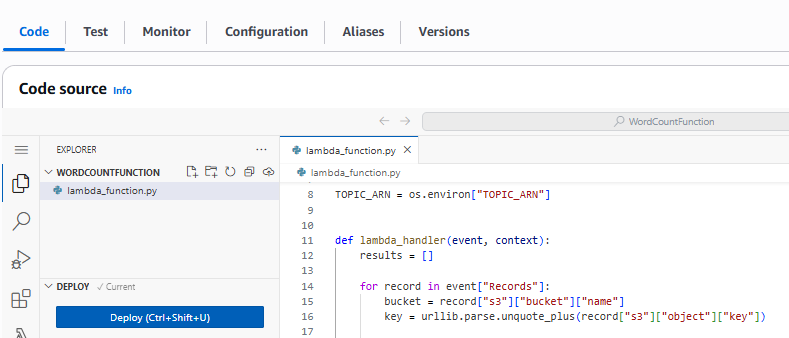

### 5️⃣ Perfil de execução
A função usando o perfil **`LambdaAccessRole`**, que dá acesso ao S3, ao SNS e ao CloudWatch Logs.

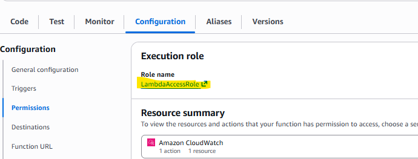

### 6️⃣ Variável de ambiente
A variável **`TOPIC_ARN`**, que guarda o ARN do tópico SNS usado pelo código.

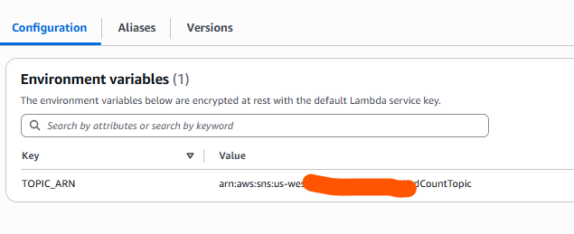

### 7️⃣ Função com o gatilho do S3
O **Function overview** da `WordCountFunction` com o **S3** conectado como gatilho e a mensagem de que o gatilho foi adicionado com sucesso.

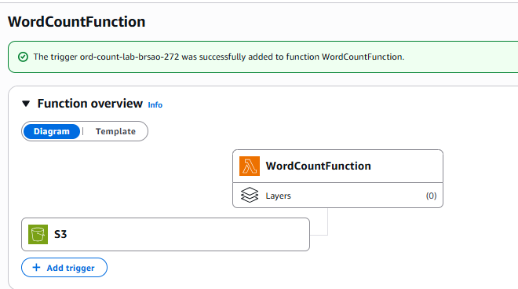

### 8️⃣ Configuração do gatilho
O gatilho do S3 com o evento **`s3:ObjectCreated:*`** e o sufixo **`.txt`**, de modo que apenas arquivos de texto acionem a função.

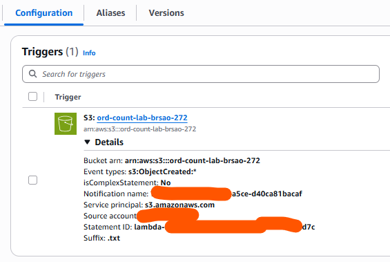

### 9️⃣ Arquivos enviados ao bucket
Os três arquivos de teste (`sample1.txt`, `sample2.txt` e `sample3.txt`) no bucket.

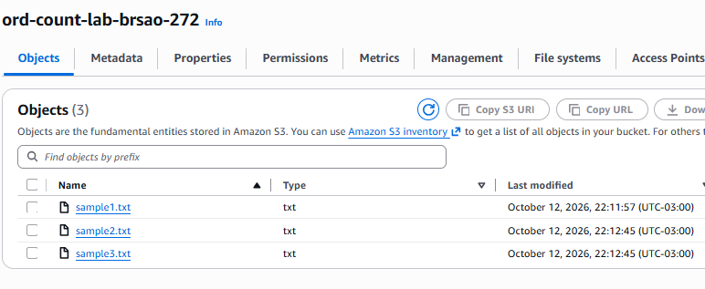

### 🔟 E-mails com a contagem de palavras
Os três e-mails com o assunto **Word Count Result**, com as mensagens `...sample1.txt file is 3.`, `...sample3.txt file is 20.` e `...sample2.txt file is 9.`

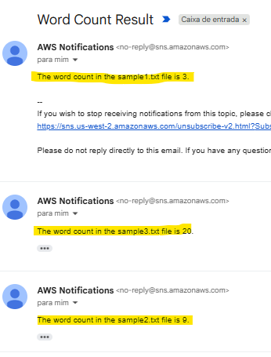

### 1️⃣1️⃣ Logs no CloudWatch
O log da execução do `sample2.txt`: eventos `START`, a mensagem **"The word count in the sample2.txt file is 9."** e `END`. O relatório mostra duração de cerca de **485 ms**, com **128 MB** de memória configurada e **99 MB** usados.

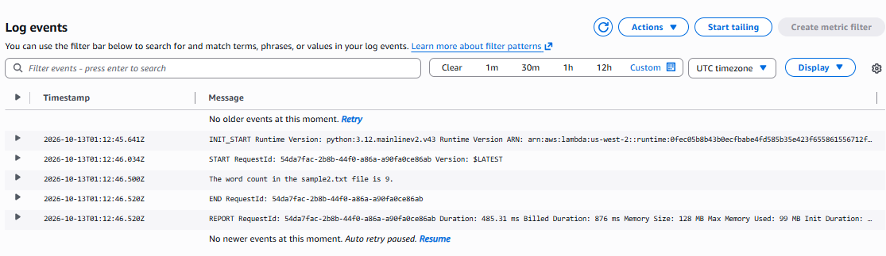

---

## 🧠 Aprendizados

- ⚡ Como funciona uma arquitetura **orientada a eventos**: o upload no S3 dispara o código, sem servidor ligado esperando
- 🔗 Como configurar um **gatilho do S3** na Lambda, com filtro por **sufixo**
- 🔐 O papel do **perfil IAM** da função e por que o laboratório fornece o `LambdaAccessRole`
- 🧩 O uso de **variáveis de ambiente** para não deixar configurações fixas no código
- 📣 O **SNS** só entrega e-mail depois que a assinatura é **confirmada**
- 🌎 Bucket, tópico e função precisam estar na **mesma região**
- 📊 Os **logs do CloudWatch** mostram cada execução, a duração e a memória usada
- 💰 Na Lambda, o custo é por **execução e tempo**, e não por servidor ligado

---

## 🔐 Observação sobre os prints

> ⚠️ Os recursos que aparecem nas imagens pertencem a um **ambiente temporário de laboratório**, já encerrado. IDs de conta e ARNs foram cobertos. Em projetos reais, evite publicar IDs de conta, endereços de e-mail e chaves de acesso.

---

<div align="center">

### 👩‍💻 Autora

**LUCIANA RB DE ASSIS**

[](https://www.linkedin.com/in/lucianarbassis)
[](https://github.com/alra-code)

⭐ Se este projeto foi útil, deixe uma estrela no repositório!


</div>
